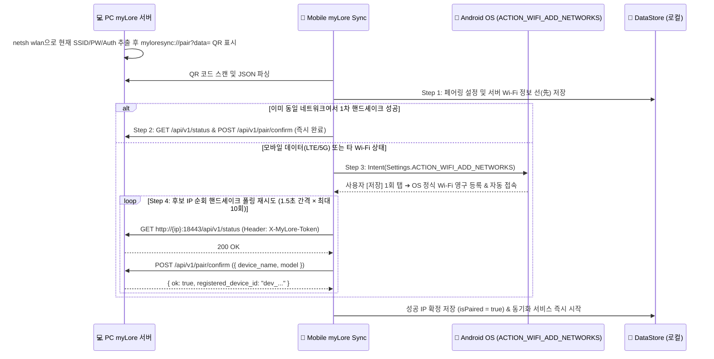
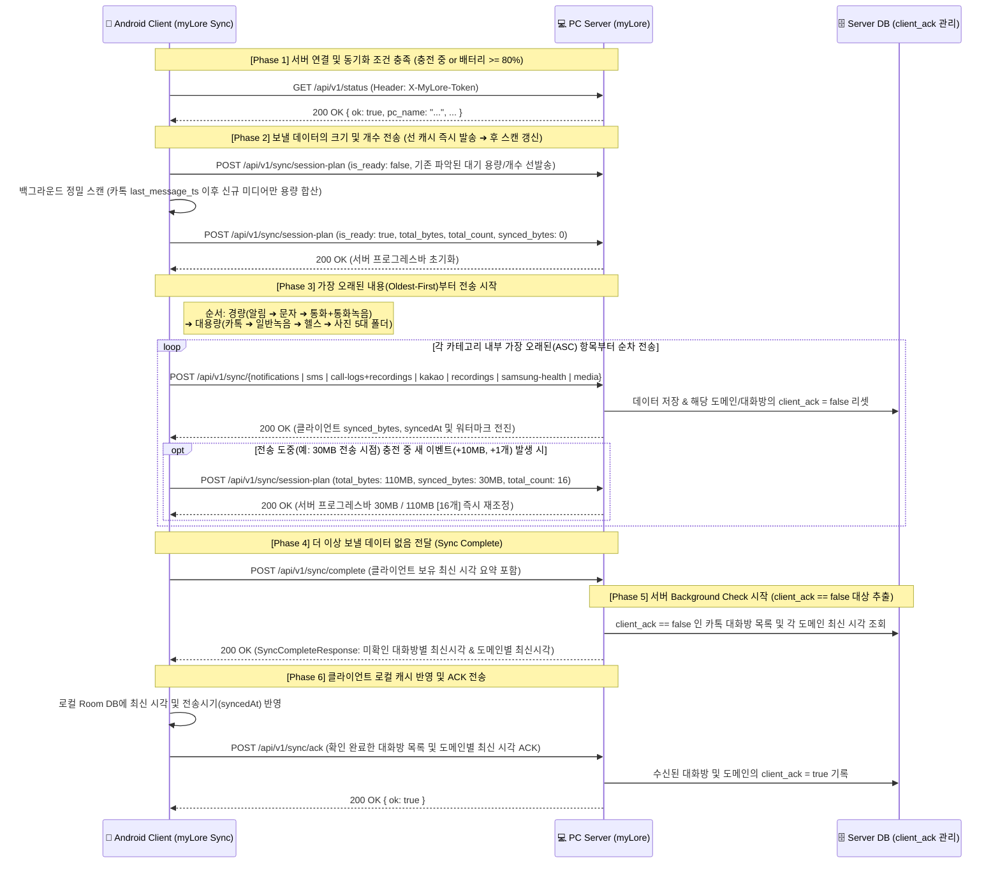

# myLore Sync 통신 및 동기화 프로토콜 명세서 (`MYLORE_SYNC_COMM_SPEC.md`)

> **문서 목적**: 안드로이드 클라이언트(`myLore Sync`)와 PC 데스크톱 서버(`myLore`) 간의 **QR 코드 자동 페어링(JSON Schema, 딥링크, 방식 A + 폴링 재시도)**, **다중 기기(Multi-Device) 식별 프로토콜**, **v2.0 통합 동기화 프로토콜(2대 조건, `session-plan`, Oldest-First 전송, 통화+녹음 결합, 사진 5대 폴더 공유, 서버 Background Check 및 `client_ack` 상태 머신)**, **REST API 전체 규격**, 그리고 **PC 서버 내부 수신·중복방지·스크립트 변환 파이프라인**을 정의하는 통신 기술 사양서입니다.  
> **관련 문서**:
> - 총괄 시스템 아키텍처 및 로컬 DB/권한 명세: [`MYLORE_SYNC_SPEC.md`](./MYLORE_SYNC_SPEC.md)
> - 모바일 UI/UX 및 10대 화면 표 상세 명세: [`MYLORE_SYNC_UI_SPEC.md`](./MYLORE_SYNC_UI_SPEC.md)  
> **최종 수정일**: 2026-11-01

---

## 1. QR 코드 기반 자동 페어링 및 원스톱 Wi-Fi 연결 프로토콜

### 1.1 QR 코드 인코딩 형식 (Deep-Link URI Scheme & JSON Schema)
- PC `myLore` 대시보드의 QR 코드는 스마트폰 기본 카메라 앱으로 비추기만 해도 즉시 `myLore Sync` 앱을 호출하고 설정값을 넘겨주는 **Custom URI Scheme 딥링크 문자열**을 제공합니다 (앱 내 `QrScannerActivity`에서는 딥링크와 순수 Base64/JSON 모두 하위 호환 파싱):
  ```text
  myloresync://pair?data=<Base64_Encoded_JSON_Payload>
  ```
- PC `myLore` 앱은 별도의 체크박스 없이 관리자 권한(UAC)이 불필요한 `netsh wlan show interfaces` 및 `netsh wlan show profile name="<SSID>" key=clear` 명령으로 현재 연결된 Wi-Fi의 SSID, 비밀번호(`Key Content`), 인증 방식(`WPA2`/`WPA3`/`OPEN` — 혼합 공유기는 호환성을 위해 `"WPA2"` 우선)을 추출하여 아래 JSON 구조로 인코딩합니다:

```json
{
  "v": 1,
  "pc_name": "MYLORE-DESKTOP",
  "ips": [
    "192.168.0.15",
    "10.0.0.5"
  ],
  "port": 18443,
  "token": "mylore_sec_a8f9c1d2e3f4567890abcdef12345678",
  "ssid": "seohyun5G",
  "wifi_pw": "mypassword1234",
  "wifi_auth": "WPA2",
  "ssids": [
    "seohyun5G"
  ],
  "created_at": 1761650000000
}
```

#### QR 페이로드 필드 명세
| 필드명 | 타입 | 설명 |
| :--- | :--- | :--- |
| `v` | Integer | 페어링 프로토콜 버전 (기본값: `1`) |
| `pc_name` | String | PC 서버 식별용 이름 |
| `ips` | Array\<String\> | PC의 로컬 네트워크 IP 목록 (다중 NIC/Wi-Fi 대응) |
| `port` | Integer | PC `myLore` HTTP 서버 포트 (기본값: `18443`) |
| `token` | String | 양방향 REST API 인증용 고유 보안 토큰 (`X-MyLore-Token`) |
| `ssid` | String | PC 서버가 현재 연결된 공유기 Wi-Fi 네트워크 식별자 |
| `wifi_pw` | String | PC 서버 소속 Wi-Fi 네트워크 비밀번호 |
| `wifi_auth` | String | Wi-Fi 인증 방식 (`WPA2`, `WPA3`, `OPEN`, 기본값 `"WPA2"`) |
| `ssids` | Array\<String\> | 하위 호환용 허용 SSID 배열 (`ssid`가 0번 인덱스에 위치) |
| `created_at` | Long | QR 코드 생성 타임스탬프 (ms) |

---

### 1.2 4단계 원스톱 페어링 파이프라인 (`방식 A + 폴링 재시도 결합`)
모바일 데이터(LTE/5G)나 다른 공유기에 연결된 상태에서 QR을 스캔하더라도 실패하지 않고 공유기 연결부터 서버 인증까지 완료하기 위해 아래 4단계로 동작합니다:

1. **Step 1 — QR 페어링 정보 선(先) 저장 (`AppPreferences.savePairingInfo`)**:
   - 서버 핸드셰이크 성공 여부와 무관하게 QR 스캔 즉시 `ips.first()`, `port`, `token`, `pc_name`, `ssid`, `wifi_pw`를 로컬 `DataStore`에 먼저 저장합니다.
2. **Step 2 — 빠른 1차 핑 체크**:
   - 이미 휴대폰이 서버와 같은 공유기에 연결된 경우(2.4GHz/5GHz 대역 분리 또는 `<unknown ssid>` 상태 포함)를 위해 후보 `ips`로 1회 빠른 핸드셰이크를 먼저 시도합니다. 성공 시 Wi-Fi 팝업 없이 1초 만에 페어링을 완료합니다.
3. **Step 3 — 방식 A (`Settings.ACTION_WIFI_ADD_NETWORKS`)로 OS 정식 Wi-Fi 영구 등록**:
   - 1차 핑이 실패하고 `ssid`가 현재 연결된 SSID와 다를 경우:
   - **Android 11 (API 30)+**: `Intent(Settings.ACTION_WIFI_ADD_NETWORKS)`에 `Settings.EXTRA_WIFI_NETWORK_LIST`(`ArrayList<WifiNetworkSuggestion>`)를 담아 시스템 모달을 호출합니다. 사용자가 **[저장] 1회만 탭**하면 비밀번호 입력 없이 OS 정식 저장 네트워크로 영구 등록 및 자동 연결됩니다.
   - **Android 10 (API 29) 이하**: `WifiManager.addNetworkSuggestions()` + `WifiNetworkSpecifier` 및 클립보드 비밀번호 복사로 연결을 유도합니다.
4. **Step 4 — 다중 후보 IP 순회 & 핸드셰이크 자동 폴링 재시도 (1.5초 간격 × 최대 10~12회)**:
   - 공유기 접속 및 DHCP IP 할당이 완료될 때까지 약 15초 동안 모든 후보 `ips`에 대해 `GET /api/v1/status` 및 `POST /api/v1/pair/confirm`을 자동 재시도하며, 성공 즉시 `RealtimeSyncForegroundService`를 기동합니다.



---

## 2. 다중 기기(Multi-Device) 연결 및 기기별 독립 워터마크 규격

1. **다중 스마트폰 동시 등록 유지**:
   - PC 서버는 동일한 보안 토큰 아래 여러 대의 스마트폰(`paired_devices` 테이블)을 동시에 등록·관리하며, 특정 기기 제거 시 해당 `device_id`만 개별 해제합니다.
2. **기기 식별 헤더 및 쿼리 파라미터**:
   - 모든 REST API 요청 시 아래 인증 및 기기 식별 헤더를 포함합니다:
     ```http
     X-MyLore-Token: mylore_sec_a8f9c1d2e3f4567890abcdef12345678
     X-MyLore-Device-Id: dev_a1b2c3d4
     X-MyLore-Device-Name: Galaxy S24 Ultra
     ```
   - `GET /api/v1/status?device_id=<device_id>` 호출 시 PC 서버는 **해당 기기 전용 워터마크(`last_*_ts`)**를 반환하여 기기 A와 기기 B 간 동기화 시점 충돌을 방지하고, 수신된 모든 라이프로그 레코드에 수집 기기 출처(`device_id`, `device_name`)를 함께 기록합니다.

---

## 3. 🔄 최종 통합 동기화 프로토콜 명세 (v2.0)

### 3.1 2대 동기화 조건 (배터리 히스테리시스 포함)
Wi-Fi SSID 강제 일치 조건을 제거하고 아래 **2대 조건**으로 동작합니다:

| 조건 항목 | 진입(시작) 조건 | 유지(히스테리시스 하한선) 조건 | 중단(Pause) 동작 |
| :--- | :--- | :--- | :--- |
| **1. 배터리 상태** | **충전 중**(`CHARGING` / `FULL`) **OR** **배터리 잔량 $\ge$ 80%** | 비충전 상태더라도 **배터리 잔량 $\ge$ 75%** 까지는 현재 동기화 세션 유지 | 비충전 상태에서 배터리가 **75% 미만($<$ 75%)**으로 하락 시 현재 단일 파일/배치 완료 후 즉시 일시정지 |
| **2. 서버와의 연결** | `GET /api/v1/status` 응답 `200 OK` (`ok: true`) | 전송 중 서버 응답 정상 유지 | 네트워크 단절 또는 연속 타임아웃 발생 시 즉시 루프 중단 및 지수 백오프 대기 전환 |

---

### 3.2 End-to-End 통합 동기화 시퀀스



---

### 3.3 세션 전송 계획 (`POST /api/v1/sync/session-plan`) 및 동적 프로그레스 갱신

1. **선(先) 발송 · 후(後) 갱신**:
   - 연결 직후 로컬 캐시 기준으로 즉시 1차 전송(`"is_ready": false`)하고, 백그라운드 정밀 스캔 완료 후 최종 용량과 개수로 2차 전송(`"is_ready": true`)합니다.
2. **카테고리별 용량(`Bytes`) 및 볼륨 개수(`Count`) 산정 기준**:

| 카테고리 키 | 볼륨 개수 (`total_count`) 산정 기준 | 데이터 용량 (`total_bytes`) 산정 기준 | 비고 |
| :--- | :--- | :--- | :--- |
| **`kakao`** | 미전송 카톡 내보내기 **폴더(대화방) 개수** | `KakaoTalkChats.txt` 크기 + **전송 대상 신규 미디어(`last_message_ts` 이후 파일) 바이트 합계** | `last_message_ts` 이전 미디어는 제외 |
| **`sms`** | 미전송 문자(SMS/MMS/RCS) **레코드 건수** | `0` (건수만 카운트) | DB형 데이터 |
| **`notification`** | 미전송 알림 **레코드 건수** | `0` (건수만 카운트) | DB형 데이터 |
| **`call`** | 미전송 **통화 이벤트(통화기록 + 매칭 통화녹음 결합) 건수** | 매칭된 미전송 **통화 녹음 오디오 파일(`Call`/`TPhoneCallRecords`) 바이트 합계** | 통화기록+녹음 단일 이벤트 결합 |
| **`recording`** | 미전송 **순수 일반 음성 녹음 파일 개수** (통화녹음 제외) | 미전송 일반 음성 녹음(`Voice Recorder`, 워치 녹음) 바이트 합계 | 통화녹음은 `call`로 분리 |
| **`health`** | 미전송 헬스 폴더 내 **개별 파일(`.csv` + `.json`)의 총개수** | 전송 대상 `.csv` 및 `.json` 파일들의 바이트 합계 | 폴더 수가 아닌 개별 파일 수 |

3. **충전 중 새 이벤트 발생 시 동적 업데이트**:
   - 예: `100MB (15개)` 중 `30MB` 전송 시점에 `10MB (1개)` 새 이벤트가 발생하면 `total_bytes: 110MB`, `synced_bytes: 30MB`, `total_count: 16`으로 `session-plan`을 재전송하여 서버 프로그레스바를 `30M / 110M (16개)`로 즉시 갱신합니다.

---

### 3.4 도메인별 증분 전송 상세 규칙 (Oldest-First)

#### 1) 전송 우선순위
- **1순위 (경량 실시간 데이터)**: `알림(Notification)` ➔ `문자(SMS/MMS)` ➔ `통화(통화기록 + 매칭 통화녹음)`
- **2순위 (대용량 파일 데이터)**: `카카오톡(KakaoTalk)` ➔ `일반 음성녹음(Voice Recordings)` ➔ `삼성 헬스(Samsung Health)` ➔ `사진(Photo 5대 폴더)`
- 모든 카테고리는 내부적으로 **가장 오래된 항목(`timestamp ASC`)**부터 순차 전송하며, 전송 성공 시마다 로컬 DB의 `isSynced = true`, `syncedAt = System.currentTimeMillis()` 및 워터마크를 즉시 전진시킵니다.

#### 2) 통화 기록 + 통화 녹음(`Call` / `TPhoneCallRecords`) 결합 및 60초 유예 규칙
- **최신 통화 60초 지연(Grace Period)**: 통화 종료 시각(`call.ts + call.durationSec * 1000`)으로부터 **60초가 지나지 않은 최신 통화**는 통화 녹음 파일이 디스크에 완전히 기록될 때까지 전송 및 완료 판정을 보류합니다.
- **매칭 통화 녹음이 존재하는 경우**: 전화번호 끝 8자리가 일치하고 녹음 시각이 통화 시간대와 매칭되는 녹음 파일(`Call` 또는 `TPhoneCallRecords`)이 있으면, `POST /api/v1/sync/call-logs`와 `POST /api/v1/sync/call-recordings`가 **모두 성공해야** 해당 통화 이벤트를 완료 처리합니다.
- **고아(Orphan) 통화 녹음 파일 업로드**: 통화 기록 DB 범위를 벗어난 과거 통화 녹음 파일이 단말에 남아있는 경우에도 누락 없이 `POST /api/v1/sync/call-recordings`로 업로드합니다.

#### 3) 카카오톡 대화방 폴더 단위 동기화 & `last_message_ts` 이후 미디어 필터링
- 동일 대화방의 내보내기 폴더가 여러 개면 가장 최신 폴더 1개만 선별합니다.
- 로컬 캐시 또는 서버 Background Check를 통해 해당 대화방의 `last_message_ts`를 알고 있는 경우, 폴더 내 미디어 파일 중 **`lastModified > last_message_ts`인 신규 사진/동영상만** `/api/v1/sync/check-hashes` 대조 후 `POST /api/v1/sync/media`로 업로드합니다.
- 이어서 `KakaoTalkChats.txt`를 `POST /api/v1/sync/kakao-chats`로 전송하며, 서버가 `"verified_for_cleanup": true`를 응답하면 스마트폰의 임시 내보내기 폴더를 안전하게 자동 삭제(`Sync & Clean`)합니다.

#### 4) 사진 5대 폴더(`Camera`, `Pictures`, `Screen recordings`, `Screenshots`, `Videocaptures`) 동기화
- `PhotoMediaCollector`가 5대 폴더의 이미지(`.jpg`, `.jpeg`, `.png`, `.webp`, `.heic`, `.gif`) 및 동영상(`.mp4`, `.mkv`, `.mov`, `.webm`, `.3gp`)을 오래된 순(`takenAt ASC`)으로 스캔합니다.
- 미전송 파일을 **50개 배치 단위**로 묶어 SHA-256 해시를 계산한 뒤 `POST /api/v1/sync/check-hashes`로 서버에 이미 존재하는지 선(先) 대조합니다.
-- 서버에 이미 존재하는 해시는 파일 본문 업로드 없이 즉시 `isSynced = true, syncedAt = now`로 마킹하고, 서버에 없는(`missing_hashes`) 파일만 `POST /api/v1/sync/media` (`source_type = "photo_<폴더명>"`, `folder_name = "<폴더명>"`)로 업로드합니다.

---

### 3.5 Sync 완료(`complete`), 서버 Background Check 및 `client_ack` 상태 머신

1. **`POST /api/v1/sync/complete` 호출**:
   - 클라이언트가 대기 중인 모든 데이터를 전송 완료하면 `client_latest` 타임스탬프 요약을 담아 호출합니다.
2. **서버의 `client_ack == false` 추출 및 응답 (`SyncCompleteResponse`)**:
   - 서버는 각 카톡 대화방(`kakao_rooms`) 및 도메인(`notification`, `sms`, `call`, `recording`, `health`)의 `client_ack` 플래그를 확인하여 **`client_ack == false`인 항목만** `unacked_kakao_rooms`와 `unacked_domains`에 담아 응답합니다.
   - 구 프로토콜에서 폴더가 삭제되어 클라이언트가 존재조차 모르는 과거 대화방도 서버 DB에는 `client_ack == false`로 초기화되어 있으므로 이 응답을 통해 클라이언트 로컬 캐시(`kakao_room_cache`)로 완벽히 복원됩니다.
3. **클라이언트 로컬 캐시 반영 및 `POST /api/v1/sync/ack` 확정**:
   - 클라이언트는 수신한 대화방 정보와 도메인별 최신 시각 이하의 로컬 레코드들을 `isSynced = true, syncedAt = now`로 갱신한 뒤 `POST /api/v1/sync/ack`를 전송합니다.
   - 서버는 확인된 항목들의 `client_ack = true`를 기록하여, 이후 새 데이터가 들어와 `client_ack = false`로 리셋되기 전까지 불필요한 중복 체크를 생략합니다.

---

### 3.6 유휴(Idle) 시점 정합성 대조(`Reconciliation`) 및 과거 전체 데이터 재수집(`Full Resync`)
- **유휴 시점 Reconciliation (`POST /api/v1/sync/reconcile` / `GET /api/v1/sync/manifest`)**:
  - 실시간 전송 루프가 유휴 상태에 진입하면 단말의 로컬 캐시 요약(`local_kakao_rooms`, `local_health_records`, `local_recording_hashes`)과 서버 보유 매니페스트를 상호 대조하여 누락된 전송 완료 상태 및 검증시각(`syncedAt`)을 동기화합니다.
- **과거 모든 데이터 받아오기 (`force_full_sync` & UDP `MYLORE_FULL_RESYNC`)**:
  - PC 대시보드에서 `[과거 모든 데이터 받아오기]` 실행 시 로컬 데이터를 무차별 삭제하지 않고, 서버에 없는 누락 데이터(Gap) 중 **가장 오래된 데이터(Oldest Unsynced Record)**로 워터마크를 되감아(Rewind) 시간순(`ASC`)으로 재전송합니다.

---

## 4. REST API 엔드포인트 전체 명세표 (Mobile ↔ PC)

> **공통 헤더**:
> - `X-MyLore-Token: {token}` (필수)
> - `X-MyLore-Device-Id: {device_id}` / `X-MyLore-Device-Name: {device_name}` (권장)

| 메서드 & URI | 설명 | Request Body | Response |
| :--- | :--- | :--- | :--- |
| `GET /api/v1/status` | PC 서버 상태 및 8대 카테고리 워터마크 조회 | None (`?device_id=...`) | `{ "ok": true, "pc_name": "...", "force_full_sync": false, "last_kakao_ts": 0, "last_sms_ts": 0, "last_call_ts": 0, "last_noti_ts": 0, "last_recording_ts": 0, "last_health_ts": 0, "last_contact_ts": 0, "last_usage_ts": 0 }` |
| `POST /api/v1/pair/confirm` | QR 페어링 승인 및 기기 등록 | `{ "device_name": "Galaxy S24", "model": "SM-S921N", "android_version": "15", "app_version": "1.0" }` | `{ "ok": true, "registered_device_id": "dev_..." }` |
| `POST /api/v1/sync/session-plan` | 동기화 세션 전송 총량(바이트/건수) 및 동적 진행률 고지 | `SyncSessionPlanRequest` (`session_id`, `is_ready`, `total_bytes`, `synced_bytes`, `total_count`, `synced_count`, `volumes`) | `{ "ok": true }` |
| `POST /api/v1/sync/complete` | 클라이언트 전송 완료 선언 및 서버 Background Check(`client_ack == false`) 조회 | `SyncCompleteRequest` (`session_id`, `client_latest`) | `SyncCompleteResponse` (`has_unacked_updates`, `unacked_kakao_rooms`, `unacked_domains`, `rewind_watermarks`) |
| `POST /api/v1/sync/ack` | 서버 Background Check 항목 로컬 반영 완료 ACK | `SyncAckRequest` (`acked_kakao_rooms`, `acked_domains`) | `{ "ok": true, "acked_room_count": 2, "acked_domain_count": 5 }` |
| `POST /api/v1/sync/watermarks` | 8대 서비스별 워터마크 상호 공유 및 병합 | `{ "last_kakao_ts": ..., "last_sms_ts": ..., ... }` | `{ "ok": true, "force_full_sync": false, "last_*_ts": ... }` |
| `GET /api/v1/sync/manifest` | 서버 보유 전송 완료 매니페스트 조회 | None (`?device_id=...`) | `SyncManifestResponse` (`kakao_rooms`, `health_records`, `synced_recording_hashes`, `synced_*_ids`) |
| `POST /api/v1/sync/reconcile` | 유휴 시점 단말 캐시와 서버 매니페스트 상호 대조 | `SyncReconcileRequest` | `SyncManifestResponse` |
| `POST /api/v1/sync/batch-init` | 카톡 폴더 또는 알림 배치 총 개수 사전 등록 | `{ "service": "kakaotalk" \| "notification", "total_count": 10 }` | `{ "ok": true }` |
| `POST /api/v1/sync/check-hashes` | 파일 업로드 전 SHA-256 해시 중복 검사 | `{ "hashes": ["sha256_1", "sha256_2"] }` | `{ "ok": true, "missing_hashes": ["sha256_2"] }` |
| `POST /api/v1/sync/kakao-chats` | 카톡 대화 백업(`KakaoTalkChats.txt`) 업로드 | `multipart/form-data` (`folder_name`, `file_hash`, `modified_at`, `folder_index`, `total_folders`, `file`) | `{ "ok": true, "messages_added": 42, "overlapping_count": 15, "percent": 50, "verified_for_cleanup": true }` |
| `POST /api/v1/sync/notifications` | 수집 알림 순차 전송 (`mobile/notifications/`) | `{ "items": [...], "current_index": 1, "total_count": 10 }` | `{ "ok": true, "ack_ids": [1], "percent": 10 }` |
| `POST /api/v1/sync/sms` | SMS/MMS/RCS 증분 전송 (`mobile/sms/`) | `{ "items": [{ "id": 10, "address": "010...", "body": "...", "ts": ..., "type": "inbox" }] }` | `{ "ok": true, "ack_ids": [10], "finance_parsed": 1 }` |
| `POST /api/v1/sync/call-logs` | 통화 기록 증분 전송 (`mobile/calls/`) | `{ "items": [{ "id": 5, "number": "010...", "name": "...", "call_type": "incoming", "duration_sec": 120, "ts": ... }] }` | `{ "ok": true, "ack_ids": [5], "inserted_count": 1 }` |
| `POST /api/v1/sync/call-recordings` | 통화 녹음(`Call`/`TPhoneCallRecords`) 및 음성 녹음 업로드 & Gemini STT | `multipart/form-data` (`file_hash`, `phone_number`, `contact_name`, `recorded_at`, `file`) | `{ "ok": true, "file_hash": "...", "transcript_generated": true, "md_path": "..." }` |
| `POST /api/v1/sync/contacts` | 연락처/주소록 증분 전송 (`mobile/contacts/`) | `{ "items": [{ "contact_id": "1", "name": "...", "phones": [...], "updated_ts": ... }] }` | `{ "ok": true, "upserted_count": 1 }` |
| `POST /api/v1/sync/app-usage` | 일자별 앱 사용시간 전송 (`mobile/usage/`) | `{ "items": [{ "date": "2026-10-30", "pkg": "...", "app_name": "...", "total_foreground_ms": ..., "launch_count": ..., "last_time_used": ... }] }` | `{ "ok": true, "recorded_count": 1 }` |
| `POST /api/v1/sync/media` | 카톡 첨부 미디어, 사진 5대 폴더 미디어, 빠른 스캔 사진 업로드 | `multipart/form-data` (`taken_at`, `source_type`, `folder_name`, `file`) | `{ "ok": true, "uuid": "...", "uri": "mylore://media/..." }` |
| `POST /api/v1/sync/samsung-health` | 삼성 헬스 CSV 및 워치 GPS JSON 업로드 (`mobile/health/`) | `multipart/form-data` (`folder_name`, `relative_path`, `file_hash`, `file`) | `{ "ok": true, "gpx_created": true, "md_path": "..." }` |

---

## 5. 💻 PC(`myLore`) 서버 측 내부 수신·중복방지·스크립트화 원리

### 5.1 네트워크 대기 및 지수 백오프 깨우기 (mDNS & UDP Broadcast)
- PC에서 `myLore`가 실행되면 로컬 포트(`18443`)에서 HTTP 서버를 구동하고, mDNS(`_mylore._tcp.local.`) 및 UDP `18444` 브로드캐스트(`"MYLORE_PC_ONLINE"`)로 온라인 상태를 알립니다.
- 모바일 앱은 PC가 꺼져 있을 때 지수 백오프(30초 ➔ 1분 ➔ 3분 ➔ 최대 10분)로 폴링 주기를 늦추어 발열을 방지하다가, `"MYLORE_PC_ONLINE"` UDP 신호 수신 시 백오프를 즉시 깨고 0.1초 만에 동기화를 재개합니다.

### 5.2 멱등성(Idempotency) 및 중복 방지(Deduplication)
1. **Multipart 파트 분리 및 `file_hash` 정합성**:
   - PC 서버는 `multipart/form-data` 바운더리를 제외한 순수 파일 바이너리 파트(`name="file"`)와 클라이언트가 전달한 `SHA-256` `file_hash`를 `synced_file_hashes` 테이블에 기록하여 `/api/v1/sync/check-hashes` 대조 시 100% 일치하도록 보장합니다.
2. **메시지/알림/금융 내역 `dedup_key` Upsert**:
   - 각 카톡 대화 줄, 문자, 푸시 알림은 `dedup_key = Hash(유형 + 발생시각_초단위 + 발신자/방이름 + 본문내용)`으로 계산되어 `UNIQUE(dedup_key) ON CONFLICT IGNORE`로 적재됩니다.

### 5.3 도메인별 PC 아카이빙 및 변환 파이프라인
- **카카오톡 (`mobile/kakao/`)**: 원본 미디어 및 텍스트를 `mobile/kakao/{folder_name}/`에 보존하고, 안드로이드/PC 카톡 날짜 구분선과 다중 줄바꿈 메시지를 파싱하여 `mobile/kakao/{대화방명}.md`에 날짜 섹션(`## 📅 YYYY-MM-DD`)별로 중복 없이 병합합니다.
- **통화 및 통화녹음 Gemini STT (`mobile/calls/`)**: 원본 오디오를 `mobile/calls/audio/{YYYY}/`에 저장하고, `gemini-2.5-flash` API로 **[통화 핵심 요약 + 화자 분리 대화 스크립트]**를 생성하여 `mobile/calls/{상대방이름_또는_번호}.md`에 병합합니다.
- **문자 및 금융 자동 가계부 (`mobile/sms/`)**: 상대방별 `.md` 스크립트로 누적 기록하며, 은행/카드사 결제 알림 및 승인 문자는 `[거래일시, 금융사, 승인/입출금, 금액, 가맹점]`을 추출해 `finance_transactions` 테이블(`verify_status = 'realtime'`)에 동시 적재합니다.
- **삼성 헬스 & 워치 GPS (`mobile/health/`)**: 운동 요약 `.csv`를 `mobile/health/{YYYY-MM}_운동기록.md` 테이블로 변환하고, `location_data.json`의 GPS 좌표를 표준 **`.gpx`** 파일(`mobile/health/gpx/{YYYYMMDD_HHMMSS}_{종목}.gpx`)로 변환합니다.
- **사진 및 미디어 (`Media Inbox` / `mobile/media/`)**: 수신된 5대 폴더 사진·동영상의 EXIF 촬영 일시(`DateTimeOriginal` 또는 `taken_at`)를 기준으로 고유 `UUID`(`mylore://media/{uuid}`)를 발급하고 아카이브에 적재합니다.
- **비동기 별도 스레드 격리**: 모든 수신 엔드포인트는 SQLite WAL 모드 및 비동기 백그라운드 워커에서 처리되어 대용량 다운로드 중에도 PC에서 문서를 열람·편집하는 데 지장이 없습니다.
