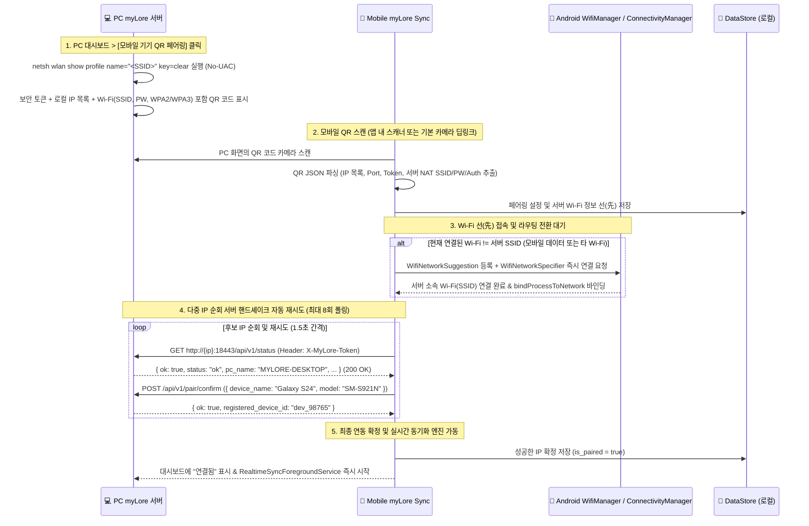

# myLore Sync (Mobile Agent) 연동 및 QR 페어링 기술 명세서

> **문서 목적**: 안드로이드 동반 앱 (`myLore Sync`)과 PC 데스크톱 앱 (`myLore`) 간의 **QR 코드 자동 페어링 프로세스**, **3대 조건 기반 실시간·증분(Delta) 동기화 아키텍처**, **6대 모바일 라이프로그(`mobile/kakao`, `sms`, `calls`, `contacts`, `notifications`, `usage`) `.md` 스크립트 아카이빙 규격**, **통화 녹음 Gemini STT 변환 파이프라인**, 그리고 **단계별 개발 마일스톤(Phase 1~5)**을 정의하는 종합 기술 사양서입니다.  
> **문서 위치**: `C:/git/myLoreSync/MYLORE_SYNC_SPEC.md`  
> **최종 수정일**: 2026-10-30

---

## 1. 프로젝트 기본 규격

- **앱 이름**: myLore Sync
- **패키지명**: `com.iseohyun.mylore.sync`
- **최소 SDK (minSdk)**: 24 (Android 7.0)
- **타겟 SDK (targetSdk / compileSdk)**: 37 (Android 15+)
- **UI 프레임워크**: Jetpack Compose + Material 3
- **핵심 기술 스택**:
  - **Local Storage**: Room DB (미전송 알림/이벤트 큐, 카톡 대화방별 오프셋 캐시), DataStore Preferences (연결 설정 및 증분 타임스탬프 워터마크 캐시)
  - **Networking**: Retrofit2 + OkHttp3 + Gson (REST API & Multi-part)
  - **Background Engine**: Foreground Service (`dataSync`), BroadcastReceiver, ContentObserver
  - **Camera & Barcode**: CameraX + ZXing (QR 코드 페어링 & QuickCam)

---

## 2. QR 코드 기반 자동 페어링 (QR Pairing Process)

컴퓨터에 익숙하지 않은 사용자도 IP 주소나 포트, 복잡한 인증 토큰을 직접 입력할 필요 없이 **카메라로 PC 화면의 QR 코드를 스캔하기만 하면 1초 만에 연동이 완료**되는 간편 페어링 프로세스입니다.

### 2.1 QR 코드 페어링 데이터 포맷 (JSON Schema)

PC `myLore` 앱은 관리자 권한(UAC) 없이도 `netsh wlan show profile name="<SSID>" key=clear` 명령을 통해 현재 연결된 Wi-Fi의 SSID, 비밀번호(`Key Content`), 인증 방식(`WPA2`/`WPA3`)을 즉시 읽어와, `라이프로그 수집 대쉬보드(F8) > 모바일 기기 QR 페어링` 화면에서 아래의 구조를 가지는 **JSON 데이터**(또는 `myloresync://pair?data=<Base64_JSON>` 딥링크 URI)를 QR 코드로 화면에 렌더링합니다:

```json
{
  "v": 1,
  "pc_name": "MYLORE-DESKTOP",
  "ips": [
    "192.168.0.15",
    "10.0.0.5"
  ],
  "port": 18443,
  "token": "mylore_sec_a8f9c1d2e3f4567890abcdef12345678",
  "ssid": "iseohyun",
  "wifi_pw": "mypassword1234",
  "wifi_auth": "WPA2",
  "created_at": 1761650000000
}
```

#### 필드 설명:
| 필드명 | 타입 | 설명 |
| :--- | :--- | :--- |
| `v` | Integer | 페어링 프로토콜 버전 (기본값: `1`) |
| `pc_name` | String | PC 서버 식별용 이름 |
| `ips` | Array<String> | PC의 로컬 네트워크 IP 목록 (이중 랜카드/Wi-Fi 대응) |
| `port` | Integer | PC myLore HTTP 서버 포트 (기본값: `18443`) |
| `token` | String | 양방향 REST API 인증용 고유 보안 토큰 (`X-MyLore-Token`) |
| `ssid` | String | PC 서버가 소속된 NAT 공유기 Wi-Fi 네트워크 식별자 (`netsh wlan`으로 자동 추출) |
| `wifi_pw` | String | PC 서버 소속 Wi-Fi 네트워크 비밀번호 (`netsh wlan ... key=clear`의 `Key Content`) |
| `wifi_auth` | String | Wi-Fi 인증 방식 (`WPA2`, `WPA3`, `OPEN` 등, 기본값: `"WPA2"`) |
| `created_at` | Long | QR 코드 생성 타임스탬프 (ms) |

> **Wi-Fi 선(先) 접속 → 핸드셰이크 자동 재시도 파이프라인**:
> 기존처럼 사설 IP(`192.168.x.x`)로 서버 핸드셰이크를 먼저 시도하고 성공했을 때만 `WifiConnector`를 호출하면, 다른 네트워크(모바일 데이터 LTE/5G 또는 다른 공유기)에서 QR을 찍었을 때 사설 IP 라우팅이 불가능해 Wi-Fi 연결 시도조차 하지 않고 실패합니다.
> 따라서 **`1) QR 페어링 정보 선(先) 저장 ➔ 2) 서버 소속 Wi-Fi 선(先) 접속(WifiNetworkSuggestion + WifiNetworkSpecifier) 및 네트워크 바인딩 대기 ➔ 3) 다중 후보 IP 순회 핸드셰이크 자동 재시도`** 순서로 동작하여 어떤 네트워크 상태에서든 원스톱 연결을 보장합니다.

---

### 2.2 QR 페어링 핸드셰이크 시퀀스 (Pairing Sequence)



---

## 3. 핵심 아키텍처 및 6대 카테고리 폴더 구조 (`mobile/`)

PC 서버(`myLore`)는 모바일에서 수신한 모든 데이터를 아카이브(`data` 볼트, 예: `C:\Users\iseoh\OneDrive\iseohyunDocs`) 하위의 **`mobile/`** 통합 폴더 내에 **6개 영문 카테고리 폴더**로 분류하여 마크다운(`.md`) 스크립트 형태로 영구 보관 및 증분 업데이트(Append/Upsert)합니다:

```text
<Archive Root (iseohyunDocs)>/
├── .agentSearchGuide.md             # [전역 AI 라우팅 가이드] 전체 볼트(프로젝트/일기/차량/부동산/모바일) 검색 색인 지도
└── mobile/                          # 스마트폰 통합 아카이브 폴더 (구 _Backup 폐기)
    ├── kakao/                       # 1. 카카오톡 대화방별 .md 스크립트 및 첨부 미디어 (media/)
    ├── sms/                         # 2. 문자(SMS/MMS) 상대방별 수발신 .md 스크립트
    ├── calls/                       # 3. 통화 수발신 이력 + 통화 녹음 Gemini STT 대화록 .md 스크립트 (audio/)
    ├── contacts/                    # 4. 연락처/주소록 통합 및 인물별 .md 문서
    ├── notifications/               # 5. 앱 푸시 알림/알람 월별 .md 타임라인
    └── usage/                       # 6. 휴대폰 앱별 사용시간(Screen Time / Digital Wellbeing) .md 리포트
```

### 모바일 앱(`myLore Sync`) 패키지 구조
```text
com.iseohyun.mylore.sync/
├── data/
│   ├── local/
│   │   ├── AppDatabase.kt            # Room Database
│   │   ├── dao/                      # NotificationDao, SyncLogDao, KakaoRoomOffsetDao
│   │   └── entity/                   # NotificationEntity, SyncLogEntity, KakaoRoomOffsetEntity
│   ├── prefs/
│   │   └── AppPreferences.kt         # DataStore (IP, Port, Token, SSIDs, last_*_ts 워터마크)
│   └── remote/
│       ├── MyLoreApiService.kt       # Retrofit2 Interface
│       ├── ApiClient.kt              # OkHttp Client (Interceptor, Timeout)
│       └── dto/                      # StatusResponse, Sync*Request/Response
├── collector/
│   ├── MyloreNotificationListener.kt # 1. 상단바 알림 (카톡/금융/앱 알림) 실시간 캡처
│   ├── SmsAndMmsCollector.kt         # 2. SMS/MMS 증분 수집 (ts > last_sms_ts)
│   ├── CallLogCollector.kt           # 3. 통화기록 증분 수집 (ts > last_call_ts)
│   ├── CallRecordingCollector.kt     # 4. 통화 녹음 음성파일(.m4a/.amr) 증분 스캔 (Recordings/Call)
│   ├── ContactsCollector.kt          # 5. 연락처/주소록 증분 수집 (updated_ts > last_contact_ts)
│   ├── AppUsageCollector.kt          # 6. 휴대폰 앱 사용시간 수집 (UsageStatsManager, ts > last_usage_ts)
│   └── KakaoChatFolderWatcher.kt     # 7. Documents/KakaoTalk/Chats 대화방별 증분 슬라이싱(Delta Slicing)
├── engine/
│   ├── SyncConditionMonitor.kt       # [Wi-Fi] AND [충전 중] AND [PC 통신 가능] 3대 조건 판별
│   └── RealtimeSyncForegroundService.kt # Foreground Service (Initial Dump + Delta Push)
```

---

## 4. 증분 동기화(Delta Sync) 상세 프로토콜 (추가된 내용만 업데이트)

> **핵심 원칙**: 최초 동기화(`last_*_ts == 0`) 시에는 스마트폰에 저장된 **과거의 모든 이력을 오래된 순서(`ASC`)로 배치(Batch Chunk, 200~500건 단위) 수집**하여 `.md` 파일로 생성하고, 이후 동기화 시에는 **마지막 업데이트 시점(`last_*_ts`) 이후에 새로 추가·변경된 데이터만 추출하여 전송**합니다.

### 4.1 카카오톡 내보내기(`Documents/KakaoTalk/Chats`) 스마트 증분 슬라이싱 & 자동 정리
카카오톡 `[대화 내용 내보내기]`를 실행할 때마다 `KakaoTalk_Chats_YYYY-MM-DD_hh.mm.ss_...` 폴더가 새로 생성되며, 내부의 `KakaoTalkChats.txt`에는 처음부터 현재까지의 모든 대화가 누적되어 들어갑니다. 용량 폭발과 중복 파싱을 막기 위해 다음 **4단계 증분 알고리즘**을 적용합니다:

1. **대화방 고유 키(`room_key`) 추출 및 최신 폴더 단일 선택**:
   - 각 하위 폴더 내 `KakaoTalkChats.txt`의 **1번째 줄**(`{방이름} 님과 카카오톡 대화`)에서 `room_name`을 추출합니다.
   - 동일한 `room_name`을 가진 내보내기 폴더가 여러 개 존재할 경우, 가장 마지막에 내보낸 폴더(`modifiedAt`이 가장 큰 폴더)에 이전 대화가 100% 포함되어 있으므로 **가장 최신 폴더 1개만 동기화 대상**으로 삼고 이전 중복 폴더는 건너뜁니다.
2. **바이트 오프셋(`last_byte_offset`) + 마지막 줄 해시(`last_line_hash`) 기반 Delta Slicing**:
   - `GET /api/v1/status` (또는 `/api/v1/sync/kakao-room-state`) 응답에는 PC 서버가 기억하는 대화방별 상태(`room_name`, `last_file_hash`, `last_byte_offset`, `last_msg_line`)가 포함됩니다.
   - 모바일 앱은 새 `KakaoTalkChats.txt` 파일의 크기가 `last_byte_offset`보다 클 경우, 파일 전체를 읽지 않고 **`RandomAccessFile.seek(last_byte_offset)` 근처로 점프**하여 `last_msg_line` 이후에 **새로 추가된 텍스트 줄(Delta Lines)만 슬라이싱**하여 전송합니다.
   - PC 서버는 수신한 증분 대화 줄을 파싱(`YYYY년 M월 D일 오전/오후 H:MM, 발신자 : 내용` 및 줄바꿈 연속 메시지 지원)하여 `mobile/kakao/{방이름}.md` 파일 하단에 날짜 섹션(`## 📅 YYYY-MM-DD`)별로 중복 없이 Append합니다.
3. **첨부 미디어(사진/동영상) 해시 사전 대조 (`/api/v1/sync/check-hashes`)**:
   - 내보내기 폴더 내의 `.jpg`, `.png`, `.mp4` 파일들은 업로드 전 SHA-256 해시 목록을 `/api/v1/sync/check-hashes`로 먼저 조회하여, PC에 없는 **신규 미디어 파일만 업로드**(`mobile/kakao/media/{방이름}/`에 저장)합니다.
4. **스마트폰 내보내기 폴더 자동 청소 (`Sync & Clean`, 선택 옵션)**:
   - PC 서버가 `.md` 병합 및 `synced_file_hashes` 등록을 완료하고 `{ "ok": true, "verified_for_cleanup": true }`를 반환하면, 모바일 앱은 이미 동기화가 끝난 이전 내보내기 폴더를 삭제하여 스마트폰 저장공간을 확보할 수 있습니다.

### 4.2 통화이력(`CallLog`) + 통화 녹음 음성파일(`Call Recordings`) Gemini STT 스크립트화
1. **통화 수·발신 이력 (`POST /api/v1/sync/call-logs`)**:
   - `CallLog.Calls.DATE > last_call_ts` 조건으로 과거 전체 통화이력(이후 증분)을 조회하여 300건 단위로 전송합니다.
   - PC 서버는 이를 `mobile/calls/{상대방이름_또는_번호}.md` 및 `mobile/calls/_통화이력_타임라인.md`에 스크립트 형태로 기록합니다.
2. **통화 녹음 음성 파일 수집 및 Gemini STT 대화록 생성 (`POST /api/v1/sync/call-recordings`)**:
   - 모바일 앱(`CallRecordingCollector`)은 안드로이드 통화 녹음 경로(`/sdcard/Recordings/Call/` 또는 `/sdcard/Call/`)에서 `.m4a`, `.amr`, `.mp3`, `.wav` 파일을 스캔하고, `/api/v1/sync/check-hashes`로 아직 전송되지 않은 녹음 파일만 PC로 업로드합니다.
   - PC 서버는 원본 오디오를 `mobile/calls/audio/{YYYY}/`에 저장하고, 설정된 **Gemini API (`gemini-2.5-flash`)**에 오디오를 전달하여 **[통화 핵심 요약 + 화자 분리 대화 스크립트]**를 생성한 뒤 `mobile/calls/{상대방이름_또는_번호}.md`에 자동으로 병합합니다.

### 4.3 문자(`SMS/MMS`), 연락처(`Contacts`), 알람(`Notifications`), 휴대폰 사용량(`App Usage`) 증분 수집
- **문자 (`POST /api/v1/sync/sms`)**: `Telephony.Sms.DATE > last_sms_ts` 조건으로 수집 ➔ `mobile/sms/{상대방이름_또는_번호}.md`에 시간순 누적 Append (금융 결제 문자는 가계부 DB에도 동시 파싱).
- **연락처 (`POST /api/v1/sync/contacts`)**: `ContactsContract.Contacts.CONTACT_LAST_UPDATED_TIMESTAMP > last_contact_ts` (`android.permission.READ_CONTACTS`) 조건으로 추가·수정된 연락처 수집 ➔ `mobile/contacts/연락처_주소록.md`에 최신 상태로 Upsert. 또한 전화번호↔이름 매핑 테이블을 갱신하여 문자/통화 `.md` 생성 시 전화번호를 실제 이름으로 자동 치환.
- **알람/알림 (`POST /api/v1/sync/notifications`)**: Room DB 미전송 큐(`isSynced == false`)를 전송 ➔ `mobile/notifications/{YYYY-MM}_알람내역.md`에 누적 기록.
- **휴대폰 사용량 (`POST /api/v1/sync/app-usage`)**: 안드로이드 `UsageStatsManager` (`android.permission.PACKAGE_USAGE_STATS` 권한)를 통해 일자별 앱 포그라운드 사용 시간(`totalTimeInForeground`), 마지막 사용 시각(`lastTimeUsed`), 실행 횟수를 수집 ➔ `mobile/usage/{YYYY-MM}_휴대폰사용량.md`에 일자별 스크린타임 리포트로 누적 기록.

---

## 5. REST API 명세 요약 (Mobile ↔ PC)

> **인증 헤더**: 모든 요청에는 `X-MyLore-Token: {token}` (또는 `Authorization: Bearer {token}`) 헤더가 포함됩니다.

| 메서드 & URI | 설명 | Request Body | Response |
| :--- | :--- | :--- | :--- |
| `GET /api/v1/status` | PC 상태 및 8대 카테고리 증분 타임스탬프 조회 | None (또는 `device_id` 쿼리) | `{ "ok": true, "pc_name": "...", "force_full_sync": false, "last_kakao_ts": 0, "last_sms_ts": 0, "last_call_ts": 0, "last_noti_ts": 0, "last_recording_ts": 0, "last_health_ts": 0, "last_contact_ts": 0, "last_usage_ts": 0 }` |
| `POST /api/v1/pair/confirm` | QR 페어링 승인 및 기기 등록 | `{ "device_name": "Galaxy S24", "model": "SM-S921N", "android_version": "15", "app_version": "1.0" }` | `{ "ok": true, "registered_device_id": "dev_..." }` |
| `POST /api/v1/sync/watermarks` | 8대 서비스별 전송 완료 시점(워터마크) 상호 공유 및 최댓값 병합 | `{ "last_kakao_ts": 0, "last_sms_ts": 0, "last_call_ts": 0, "last_noti_ts": 0, "last_recording_ts": 0, "last_health_ts": 0, "last_contact_ts": 0, "last_usage_ts": 0 }` | `{ "ok": true, "pc_name": "...", "force_full_sync": false, "last_*_ts": ... }` |
| `POST /api/v1/sync/batch-init` | 카톡 폴더 또는 알림 배치 전송 전 총 개수(`total_count`) 사전 등록 | `{ "service": "kakaotalk" \| "notification", "total_count": 10 }` | `{ "ok": true }` |
| `POST /api/v1/sync/check-hashes` | 파일 중복 검사 (SHA-256 / BLAKE3) | `{ "hashes": ["hash1", "hash2"] }` | `{ "ok": true, "missing_hashes": ["hash2"] }` |
| `POST /api/v1/sync/kakao-chats` | 카톡 대화 백업(`KakaoTalkChats.txt`) 및 폴더 순번 전송 | `multipart/form-data` (`folder_name`, `file_hash`, `modified_at`, `folder_index`, `total_folders`, `file`) | `{ "ok": true, "messages_added": 42, "overlapping_count": 15, "percent": 50, "verified_for_cleanup": true }` |
| `POST /api/v1/sync/notifications` | 수집 알림 1건씩 순차 전송 (`mobile/notifications/`) | `{ "items": [{ "id": 1, "pkg": "...", "title": "...", "text": "...", "sub_text": "...", "ts": 176165... }], "current_index": 1, "total_count": 10 }` | `{ "ok": true, "ack_ids": [1], "percent": 10 }` |
| `POST /api/v1/sync/sms` | SMS/MMS 증분 전송 (`mobile/sms/`) | `{ "items": [{ "id": 10, "address": "010...", "body": "...", "ts": 176165..., "type": "inbox" }] }` | `{ "ok": true, "ack_ids": [10], "finance_parsed": 1 }` |
| `POST /api/v1/sync/call-logs` | 통화 기록 증분 전송 (`mobile/calls/`) | `{ "items": [{ "id": 5, "number": "010...", "name": "...", "call_type": "incoming", "duration_sec": 120, "ts": 176165... }] }` | `{ "ok": true, "ack_ids": [5], "inserted_count": 1 }` |
| `POST /api/v1/sync/call-recordings` | 통화 녹음 음성 파일 업로드 & Gemini STT 스크립트화 (`mobile/calls/`) | `multipart/form-data` (`file_hash`, `phone_number`, `contact_name`, `recorded_at`, `file`) | `{ "ok": true, "file_hash": "...", "transcript_generated": true, "md_path": "..." }` |
| `POST /api/v1/sync/contacts` | 연락처/주소록 증분 전송 (`mobile/contacts/`) | `{ "items": [{ "contact_id": "1", "name": "홍길동", "phones": ["010-1234-5678"], "emails": [], "organization": "...", "job_title": "...", "memo": "...", "updated_ts": 176165... }] }` | `{ "ok": true, "upserted_count": 1 }` |
| `POST /api/v1/sync/app-usage` | 휴대폰 앱별 사용시간 전송 (`mobile/usage/`) | `{ "items": [{ "date": "2026-10-30", "pkg": "com.kakao.talk", "app_name": "카카오톡", "total_foreground_ms": 5400000, "launch_count": 32, "last_time_used": 176165... }] }` | `{ "ok": true, "recorded_count": 1 }` |
| `POST /api/v1/sync/media` | 카톡 내보내기 미디어(원본 적재) 및 빠른 스캔 사진(QuickCam) 전송 | `multipart/form-data` (`taken_at`, `source_type`, `folder_name` (선택), `file`) | `{ "ok": true, "uuid": "...", "uri": "mylore://media/..." }` |
| `POST /api/v1/sync/samsung-health` | 삼성 헬스 및 워치 운동/GPS 데이터 업로드 (`mobile/health/`) | `multipart/form-data` (CSV/JSON 또는 ZIP 아카이브) | `{ "ok": true, "gpx_created": true, "md_path": "..." }` |

---

## 6. 단계별 개발 마일스톤 (Milestones)

### 📌 Phase 1: 패키지 정제, 의존성 구축 및 로컬/네트워크 레이어 (`완료`)
- [x] 기술 명세서 및 QR 페어링 설계 문서 작성 (`MYLORE_SYNC_SPEC.md`)
- [x] 패키지명 변경: `com.example.myloresync` ➔ `com.iseohyun.mylore.sync`
- [x] Dependencies 추가: Room, DataStore, Retrofit2, OkHttp3, CameraX, ZXing, Navigation Compose
- [x] `AndroidManifest.xml` 권한 선언 (`MANAGE_EXTERNAL_STORAGE`, `NOTIFICATION_LISTENER`, `SMS`, `CALL_LOG`, `READ_CONTACTS`, `PACKAGE_USAGE_STATS`, `LOCATION`, `CAMERA`, `FOREGROUND_SERVICE_DATA_SYNC`)
- [x] DataStore Preferences (`AppPreferences.kt`) 및 Retrofit API Service (`MyLoreApiService.kt`) 구현

### 📌 Phase 2: QR 페어링 & 7대 수집기 (Collector) 구현 (`완료`)
- [x] CameraX + ZXing 기반 QR 스캐너 액티비티 (`QrScannerActivity.kt`)
- [x] `MyloreNotificationListener`, `SmsAndMmsCollector`, `CallLogCollector`, `KakaoChatFolderWatcher` 기본 구현
- [x] `KakaoChatFolderWatcher` 고도화: 대화방별 최신 폴더 1개만 선별 + 바이트 오프셋 기반 증분 슬라이싱(Delta Slicing) 적용
- [x] `CallRecordingCollector` 추가: `/sdcard/Recordings/Call` 내 통화 녹음(`.m4a`/`.amr`) 증분 스캔 및 업로드
- [x] `ContactsCollector` 추가: `ContactsContract` 기반 연락처 증분 수집 (`last_contact_ts` 이후 변경분)
- [x] `AppUsageCollector` 추가: `UsageStatsManager` 기반 일자별 앱 사용시간(Screen Time) 수집

### 📌 Phase 3: 동기화 엔진 (Sync Engine) 및 PC 서버 `.md` 스크립트 생성기 (`완료`)
- [x] `SyncConditionMonitor` (Wi-Fi SSID + 충전 상태 + PC 서버 Ping 3대 조건 판별기)
- [x] `RealtimeSyncForegroundService` (DataSync Foreground Service: Noti, SMS, CallLog, Kakao, Contacts, AppUsage, CallRecordings 실시간 파이프라인 완비)
- [x] PC 서버 `mobile/{kakao,sms,calls,contacts,notifications,usage}` 6대 폴더 마크다운(`.md`) 자동 스크립트 변환 및 증분 Append 엔진 구현
- [x] PC 서버 `multipart/form-data` 파트 분리 파서 및 `file_hash` 정합성 검증 수정 완료

### 📌 Phase 4: 스마트 명함 스캐너 & 연락처 관리 고도화 (`완료`)
- [x] 실시간 ML Kit 다수결 누적 투표 카메라 + Google Document Scanner 3D 모서리 원근 보정 하이브리드 파이프라인
- [x] 명함 사진 수동/자동 회전 보정 다이얼로그 및 우상단 재촬영 원형 배지(`[🔄]`)
- [x] 연락처 런타임 권한 자동 요청 및 거부 시 앱 설정 화면 원클릭 이동 안내
- [x] 연락처 신규 저장 시 삼성/안드로이드 기본 클라우드 계정 바인딩 지원 (`Cannot add contacts to local or SIM accounts when default account is set to cloud` 에러 해결)
- [x] 필수 입력값(이름, 연락처) 미입력 시 인라인 에러 피드백(빨간색 테두리, 에러문구) 및 자동 스크롤/포커스 UI 구현 완료

### 📌 Phase 5: 8대 워터마크 상호 동기화, 카톡/알림 순차 파이프라인 및 모바일 UI 오버레이 개편 (`완료`)
- [x] 8대 서비스 워터마크 상호 공유 (`POST /api/v1/sync/watermarks`) 및 `force_full_sync` 리셋 처리
- [x] 카카오톡 폴더 단위 원본 적재 (`mobile/kakao/{folder_name}/`) 및 완료 확인 후 기기 내 임시 폴더 안전 자동 삭제 (`verified_for_cleanup == true`)
- [x] 알림 총 개수 사전 고지(`batch-init`) 및 1건씩 순차 전송 프로토콜 (`current_index` / `total_count`)
- [x] 모바일 UI 전면 개편: 좌측 슬라이드 오버레이 메뉴(`ModalNavigationDrawer`), 고정 상단바(`statusBarsPadding`), 9대 전용 카테고리 화면(카톡, 문자, 통화, 알림, 녹음, 헬스, 명함, 상태, 설정) 구현 및 실기기 배포 완료

---

## 7. 💻 PC 서버(`myLore`) 측 검토 코멘트 및 주의사항

1. **`multipart/form-data` 해시 일치 보장 완료**:
   - 기존에 `multipart/form-data` 업로드 시 HTTP 바운더리 문자열이 매번 달라져 해시가 다르게 계산되던 문제를 해결했습니다. 이제 PC 서버는 Multipart 내부의 `name="file_hash"` 파트와 `name="file"` 파트를 정확히 분리하여 추출하고, 안드로이드가 보낸 `SHA-256` `file_hash`를 그대로 `synced_file_hashes` 테이블에 기록합니다.
2. **안드로이드 카카오톡 내보내기 텍스트 포맷 완벽 지원**:
   - 안드로이드 카카오톡 내보내기 포맷(`2026년 10월 28일 오후 9:12, 박재홍 : 메시지내용` 및 다중 줄바꿈 메시지)과 PC 카카오톡 포맷(`[박재홍] [오후 9:12] 메시지내용`)을 모두 파싱하여 `mobile/kakao/<대화방명>.md` 문서에 날짜별(`## 📅 YYYY-MM-DD`)로 중복 없이 병합합니다.
3. **신규 권한 안내 (`READ_CONTACTS`, `PACKAGE_USAGE_STATS`)**:
   - 연락처 수집을 위해 런타임 권한 `Manifest.permission.READ_CONTACTS`를 요청해 주세요.
   - 휴대폰 사용시간 수집을 위해 `Settings.ACTION_USAGE_ACCESS_SETTINGS` 인텐트로 사용자에게 **[사용정보 접근 허용]** 권한을 안내한 뒤 `UsageStatsManager.queryAndAggregateUsageStats()`를 호출해 주세요.

---

## 8. 🔍 명함 스캐너 오류 원인 분석 및 UI 피드백 개선 마일스톤

### 8.1 오류 로그 분석 결과
- **발생 오류**: `java.lang.IllegalArgumentException: Cannot add contacts to local or SIM accounts when default account is set to cloud`
- **발생 위치**: `ContactManager.createContact()` (`ContactsContract.RawContacts.CONTENT_URI` insert)
- **발생 원인**:
  - 삼성 갤럭시 등 최신 안드로이드 기기에서 기본 연락처 저장 계정이 **Google 계정 또는 Samsung Cloud 계정**으로 설정되어 있는 경우, `ACCOUNT_NAME = null`, `ACCOUNT_TYPE = null`로 새 연락처를 로컬(휴대폰 내부) 또는 SIM 계정에 추가하려고 시도하면 안드로이드 Contacts Provider가 보안/정책상 `IllegalArgumentException`을 던지며 저장을 거부함.
- **해결 방안 (적용 완료)**:
  1. `ContactManager`에 `getPreferredAccount()`를 구현하여 기존 연락처의 `RawContacts` 및 `AccountManager`에서 활성화된 기본 클라우드 계정(Google/Samsung 계정 이름 및 타입)을 자동으로 조회.
  2. 조회된 기본 계정을 `RawContacts.withValue(ACCOUNT_NAME, accountName)`, `withValue(ACCOUNT_TYPE, accountType)`로 바인딩하여 저장하도록 수정.
  3. 프로필 썸네일 이미지가 커질 경우 Binder Transaction Buffer(1MB) 초과로 실패하는 현상을 방지하기 위해 사진을 최대 480px, 압축률 80%로 안전하게 다운샘플링 적용.

### 8.2 사용자 UI 피드백 방안 (마일스톤 태스크)
1. **필수 입력값 실시간 검증 및 인라인 피드백**:
   - **이름(Name)**: 비어있을 경우 저장 버튼 클릭 시 '이름을 입력해주세요' 빨간색 안내문구 표시 및 해당 입력창으로 자동 스크롤/포커스.
   - **연락처(전화번호/이메일)**: 휴대폰, 일반전화, 이메일이 모두 비어있는 경우 '전화번호 또는 이메일 중 최소 하나를 입력해주세요' 토스트 안내.
2. **저장 실패 시 원인 세부 피드백**:
   - 기존의 단순 모호한 문구(`연락처 저장에 실패했습니다. 입력값을 확인해주세요.`) 대신, 시스템 예외 메시지를 해석하여 맞춤형 안내(`연락처 저장 실패: [구글 계정 동기화 오류 / 저장 권한 오류 / 필수값 누락]`) 제공.

---

## 9. 🚀 2026-10-30 추가 구현 규격: 기본 카메라 QR 딥링크, 다중 기기(Multi-Device) 연동, 과거 전체 데이터 재수집(Full Resync)

### 9.1 기본 카메라 QR 촬영 시 `myLore Sync` 자동 실행 (Deep-Link URI Scheme)
1. **QR 코드 인코딩 형식 변경**:
   - PC `myLore` 대시보드의 QR 코드는 이제 순수 JSON이나 단순 Base64가 아니라, 스마트폰 기본 카메라 앱에서 QR만 비추면 즉시 `myLore Sync` 앱을 호출하고 설정값을 넘겨주는 **Custom URI Scheme 딥링크 문자열**만 제공합니다:
     ```text
     myloresync://pair?data=<Base64_Encoded_JSON_Payload>
     ```
2. **안드로이드 `AndroidManifest.xml` 인텐트 필터 추가 명세**:
   - 메인 액티비티(또는 페어링 처리 액티비티)에 아래 `<intent-filter>`를 등록합니다:
     ```xml
     <intent-filter>
         <action android:name="android.intent.action.VIEW" />
         <category android:name="android.intent.category.DEFAULT" />
         <category android:name="android.intent.category.BROWSABLE" />
         <data android:scheme="myloresync" android:host="pair" />
     </intent-filter>
     ```
3. **딥링크 수신 및 파싱 로직**:
   - `intent?.data?.scheme == "myloresync"` 및 `intent?.data?.host == "pair"` 감지 시, `intent.data.getQueryParameter("data")`로 Base64 문자열을 추출하여 Base64 디코딩 후 JSON(`v`, `pc_name`, `ips`, `port`, `token`, `ssids`)을 파싱하고 즉시 `POST /api/v1/pair/confirm`을 호출하여 페어링을 완료합니다.
   - 앱 내부 QR 스캐너(`QrScannerActivity`)에서도 `myloresync://pair?data=` 접두사가 있는 경우 `data` 파라미터를 추출하고, 기존 하위 호환을 위해 순수 Base64 문자열도 함께 처리합니다.

### 9.2 다중 기기(Multi-Device) 연결 및 기기별 독립 워터마크·출처(Attribution) 기록
1. **기기 추가 연결 (`다른 기기 연결`) 및 특정 기기 제거 (`기기 제거`)**:
   - PC 서버는 토큰을 재발급하여 기존 기기를 끊는 방식 대신, 동일한 보안 토큰 아래 여러 대의 스마트폰(`paired_devices` 테이블)을 동시에 등록·유지합니다.
   - PC 대시보드에서 특정 기기의 `[기기 제거]` 클릭 시 해당 `device_id`만 `paired_devices`에서 제거됩니다.
2. **기기 식별 헤더 및 쿼리 파라미터 (`X-MyLore-Device-Id`, `X-MyLore-Device-Name`)**:
   - 모바일 앱이 `GET /api/v1/status?device_id=<device_id>` 호출 시(또는 `X-MyLore-Device-Id` 헤더 전송 시), PC 서버는 **해당 기기 전용 워터마크(`last_noti_ts`, `last_sms_ts`, `last_call_ts`, `last_contact_ts`, `last_usage_ts`)**를 반환합니다. 이를 통해 기기 A와 기기 B의 동기화 시점이 서로 간섭하거나 누락되지 않습니다.
   - 모든 동기화 API(`POST /api/v1/sync/notifications`, `sms`, `call-logs`, `kakao-chats`, `call-recordings`, `contacts`, `app-usage`) 호출 시 HTTP 헤더에 아래 두 항목을 포함합니다(또는 JSON 루트에 `"device_id"`, `"device_name"` 포함):
     ```http
     X-MyLore-Device-Id: dev_a1b2c3d4
     X-MyLore-Device-Name: Galaxy S24 Ultra
     ```
   - PC 서버는 수신된 모든 메시지(`lifelog_messages`)와 통화 기록(`lifelog_call_logs`)에 `device_id` 및 `device_name`을 함께 저장하여 어느 기기에서 수집된 데이터인지 대시보드에 표시합니다.

### 9.3 과거 모든 데이터 받아오기 및 점진적 역방향/누락 동기화 (Backfill & Gap-Detection Sync 프로토콜)

> **핵심 설계 원칙 (No Blind Full Resets)**:  
> "과거 모든 데이터 받아오기" 시나리오는 로컬 저장소를 실제로 무차별 초기화하여 모든 데이터를 처음부터 무조건 다시 받는 것이 아닙니다.  
> **이전에 PC 서버로 이미 전달된 데이터 기록을 확인하고, 서버에 없는 누락 데이터(Gap)를 정확히 파악한 뒤, 그중 "가장 오래된 데이터(Oldest Unsynced Record)"부터 시작하여 시간순으로 차근차근 전송하는 작업**입니다.

1. **서버 연결 시 순차 스트리밍 전송 & 실시간 워터마크 갱신**:
   - 모바일 기기가 3대 조건(지정 Wi-Fi, 충전 중, myLore 서버 통신 가능)을 충족하여 서버와 연결되면, **가장 오래된 미전송 데이터(`ts > 0`인 데이터 중 최솟값)부터 시작하여 연결이 끊길 때까지 시간순(ASC)으로 차근차근 데이터를 전송**합니다.
   - 단일 레코드(또는 배치 블록)가 서버로 완전히 전송 완료(`200 OK` 및 `ACK` 수신)될 때마다, 모바일과 서버 양측은 **"전송되지 않은 가장 오래된 데이터의 시점(Oldest Unsynced Timestamp)"**을 즉시 전진(Advance) 갱신합니다.
   - 이를 통해 동기화 도중 Wi-Fi 이탈, 충전 케이블 분리 등으로 연결이 갑작스럽게 끊기더라도, 이미 완료된 레코드 시점까지 안전하게 보존되어 다음 연결 시 중단된 지점부터 즉시 이어서 전송(Resumable Streaming)됩니다.

2. **전송 불변성 규칙(Invariance Rule) 및 과거 누락 데이터(Gap) 재정의**:
   - **불변성 전제 조건**: **"전송되지 않은 가장 오래된 데이터(Oldest Unsynced Timestamp)"보다 이전 시점의 모든 과거 데이터는 반드시 서버 전송 기록이 100% 온전히 존재**해야 합니다.
   - **누락 데이터(Gap) 감지 및 워터마크 되감기(Rewind)**:
     - 동기화 시작 전(또는 백필 검사 시), "전송되지 않은 가장 오래된 시점"보다 이전 타임스탬프를 가진 데이터 중 전송 기록(`is_synced == false` 또는 서버 누락)이 없는 레코드가 발견되면, 해당 데이터는 아직 전송되지 않은 것으로 간주합니다.
     - 모바일 Sync 엔진은 발견된 누락 데이터 중 가장 과거의 시점으로 **"아직 전송되지 않은 가장 오래된 데이터"의 기준점을 즉시 재정의(Rewind)**하여, 어떤 과거 데이터도 누락 없이 완벽하게 복구 전송되도록 보장합니다.

3. **PC ➔ 모바일 재동기화 트리거 및 시퀀스**:
   - PC 대시보드 설정에서 `[과거 모든 데이터 받아오기]` 클릭 시:
     1) PC 서버는 `force_full_sync = true` 플래그 및 UDP 브로드캐스트(`MYLORE_FULL_RESYNC`)를 발송합니다.
     2) 모바일 Sync 앱은 기존 로컬 데이터를 삭제하지 않고, 서버와 대조하여 전송 완료 플래그가 비어 있거나 누락된 레코드들을 추출합니다.
     3) 추출된 누락 대상 중 **가장 오래된 데이터**부터 시작하여 서버가 연결되어 있는 동안 순차적으로 업로드 및 워터마크를 전진시킵니다.

### 9.4 카카오톡 동기화 완료 후 자동 정리 (`Sync & Clean`)
- 모바일 앱이 `POST /api/v1/sync/kakao-chats`로 내보내기 파일을 업로드한 후, PC 서버 응답에 `"verified_for_cleanup": true` 플래그가 포함되어 있으면, 모바일 앱은 스마트폰 저장 공간 확보를 위해 해당 임시 백업 폴더(`Documents/KakaoTalk/Chats/{폴더명}`)를 `deleteRecursively()`로 안전하게 자동 삭제합니다.

### 9.5 MMS(장문 문자 / 사진 첨부) 통합 수집 규격
- **수집 데이터 소스**: 안드로이드의 `content://mms`, `content://mms/part`, `content://mms/{mms_id}/addr`
- **MMS 수집 방식**:
  - `date`: MMS 테이블의 `date`는 초(Second) 단위이므로 밀리초 변환(`date * 1000L`) 적용.
  - `address`: `content://mms/{mms_id}/addr`에서 `type=137`(발신자, inbox) 또는 `type=151`(수신자, sent)을 파싱하여 발신자 번호/이름 획득.
  - `body` & 미디어: `content://mms/part`에서 `ct`(Content-Type)가 `text/plain`인 텍스트 본문과 `image/*`, `video/*`, `audio/*` 첨부파일 정보를 결합하여 `[제목]`, `[사진 첨부: 파일명]`, `본문내용` 형태로 `POST /api/v1/sync/sms`로 전송.
  - 고유 ID 체계: MMS ID 충돌을 방지하기 위해 `1_000_000_000L + mms_id` 오프셋 적용.

### 9.6 통화녹음 및 음성녹음 확장 (T전화, 삼성 음성녹음, 갤럭시 워치 음성메모)
- **탐색 디렉터리 (재귀 탐색)**:
  1. `/sdcard/Recordings/TPhoneCallRecords`: SKT T전화 통화 녹음 (파일명 형식: `#이름_전화번호_YYYYMMDDHHMMSS.m4a` 또는 `#이름(메모)_전화번호_...`)
  2. `/sdcard/Recordings/Call`: 삼성 기본 전화 통화 녹음 (파일명 형식: `통화 녹음_이름_전화번호_YYMMDD_HHMMSS.m4a`)
  3. `/sdcard/Recordings/Voice Recorder`: 삼성 기본 음성 녹음 (파일명 형식: `음성 YYMMDD_HHMMSS.m4a`)
  4. `/sdcard/Recordings/Sounds/Watch`: 갤럭시 워치 음성 메모/녹음 (파일명 형식: `음성 001_W_YYYYMMDD_HHMMSS.m4a`)
- **수집 및 메타데이터 파싱**: 파일명에서 전화번호, 상대방/녹음 유형, 녹음 시작 일시를 자동 파싱하여 `POST /api/v1/sync/call-recordings`를 통해 PC 서버로 전송. PC 서버는 이를 Gemini STT를 통해 스크립트화하여 마크다운 파일로 기록.

### 9.7 앱 사용량(`PACKAGE_USAGE_STATS`) 수집 권한 및 UI 설정 유도
- **필수 권한 선언**: `AndroidManifest.xml`에 `<uses-permission android:name="android.permission.PACKAGE_USAGE_STATS" tools:ignore="ProtectedPermissions" />` 선언 필수.
  - 해당 권한이 매니페스트에 없으면 안드로이드 OS 설정의 "사용정보 접근 허용" 앱 목록에 앱 자체가 검색되지 않고 숨겨짐.
- **UI 원클릭 설정 유도**: 대시보드 화면에서 `AppOpsManager` 권한 상태를 실시간 체크하여 미허용 시 상단 경고 배너 및 `Intent(Settings.ACTION_USAGE_ACCESS_SETTINGS)` [권한 허용] 버튼을 제공, `package:{packageName}` URI로 즉시 해당 앱 권한 설정창으로 이동 유도.

---

## 10. 삼성 헬스 & 갤럭시 워치 운동·GPS 데이터 동기화 규격

스마트폰의 `/sdcard/Download/Samsung Health/` 경로에 백업·내보내기된 삼성 헬스 및 갤럭시 워치 운동 기록을 PC 서버의 `mobile/health/` 디렉터리에 동기화하고 시각화합니다.

### 10.1 내보내기 폴더 구조 및 최신 데이터 판별
- **폴더 명명 규칙**: `samsunghealth_{사용자계정}_{YYYYMMDDHHMMSS}/`
  - 동일 폴더가 여러 개 존재할 경우 폴더명의 타임스탬프가 가장 큰 폴더를 최신으로 판별합니다. (예: `samsunghealth_iseohyun_20250429104386`이 `...101907`보다 최신)
- **주요 데이터 파일 구성**:
  1. `com.samsung.shealth.exercise.{timestamp}.csv`: 운동 세션 요약 목록 (운동 시작/종료 시각, 소모 칼로리, 심박수 요약, 운동 종류, 거리 등)
  2. `com.samsung.shealth.tracker.pedometer_day_summary.{timestamp}.csv`: 일자별 걸음수 통계
  3. `com.samsung.shealth.tracker.heart_rate.{timestamp}.csv`: 심박수 일일 요약
  4. `jsons/com.samsung.shealth.exercise/{0..f}/{UUID}.com.samsung.health.exercise.location_data.json`: **갤럭시 워치 운동 실시간 GPS 이동 경로 (초 단위 위도, 경도, 고도, 정확도)**
  5. `jsons/com.samsung.shealth.exercise/{0..f}/{UUID}.com.samsung.health.exercise.live_data.json`: **실시간 심박수 및 누적 거리 데이터**

### 10.2 PC 서버 수신 및 마크다운·GPX 변환 규격
- **엔드포인트**: `POST /api/v1/sync/samsung-health` (multipart 또는 ZIP 아카이브 업로드)
- **PC 서버 처리**:
  - `mobile/health/{YYYY-MM}_운동기록.md` 파일에 날짜별 운동 요약(종목, 소요시간, 소모 칼로리, 평균 심박수)을 테이블 형태로 자동 생성.
  - `location_data.json`의 GPS 좌표 목록을 표준 **`.gpx`** 파일(`mobile/health/gpx/{YYYYMMDD_HHMMSS}_{종목}.gpx`)로 자동 변환 저장하여 지도 뷰어에서 운동 이동 경로를 재생 및 시각화 가능하도록 지원.

---

## 11. 🔄 서비스별 워터마크 상호 공유 및 카톡(폴더 단위)·알림(1건 순차) 동기화 규격

### 11.1 서비스별 전송 완료 시점(Watermark) 상호 공유 (`POST /api/v1/sync/watermarks`)
- 모바일 Sync 앱과 PC 서버는 모든 데이터 업데이트 시 서비스별로 전송 완료 시점(`last_kakao_ts`, `last_noti_ts`, `last_sms_ts`, `last_call_ts`, `last_recording_ts`, `last_health_ts`, `last_contact_ts`, `last_usage_ts`)을 각각 기억하고 상호 공유(최댓값 병합)합니다.
- `force_full_sync == true`인 경우에만 모든 워터마크가 `0`으로 리셋됩니다.

### 11.2 카카오톡(KakaoTalk) 폴더 단위 동기화 및 원본 폴더 적재 프로토콜
1. **외부 방출 탐색 및 총 폴더 수 선발송 (`POST /api/v1/sync/batch-init`)**:
   - 사용자가 카카오톡 앱 내에서 대화 내보내기를 수행하면, 모바일 Sync 앱이 `Documents/KakaoTalk/Chats/` 내보내기 폴더들을 탐색합니다.
   - 전달할 **전체 폴더 개수(`total_count`)**를 `POST /api/v1/sync/batch-init` (`{"service": "kakaotalk", "total_count": N}`)으로 먼저 서버에 알립니다.
2. **폴더 1개씩 순차 전송 및 원본 적재 (`mobile/kakao/{folder_name}/`)**:
   - 각 폴더에 포함된 이미지·동영상 파일들을 수정하지 않고 그대로 `POST /api/v1/sync/media` (`folder_name` 포함)로 업로드하여 PC의 `mobile/kakao/{folder_name}/`에 원본 그대로 적재합니다.
   - 이어서 `KakaoTalkChats.txt`를 `folder_index` / `total_folders`와 함께 `POST /api/v1/sync/kakao-chats`로 전송합니다.
3. **기존 대화 중복 확인·병합, `.md` 메타데이터 보관, 완료 폴더 삭제**:
   - PC 서버는 수신된 대화 내용 중 기존 대화와 겹치는 부분(`overlapping_count`, 파란색 바)과 신규 부분(`messages_added`, 녹색 바)을 판별하여 `mobile/kakao/{대화방명}.md`를 업데이트하고, 상단 프론트매터에 대화 메타데이터(`raw_folder`, `participants`, `overlapping_messages`, `newly_added_messages`, `media_files_in_folder`, `last_kakao_ts`, `last_synced`)를 보관합니다.
   - PC 서버가 백분위(`percent`) 진행률을 UI에 실시간 표시하고 `"verified_for_cleanup": true`를 응답하면, 모바일 Sync 앱은 즉시 해당 내보내기 폴더를 삭제합니다.

### 11.3 알림(Notification) 총 개수 선발송 및 1건씩 순차 전달 프로토콜
1. 전달할 미동기화 알림의 **총 개수(`total_count`)**를 `POST /api/v1/sync/batch-init` (`{"service": "notification", "total_count": N}`)으로 먼저 전달합니다.
2. 이후 알림을 **1건씩(`current_index` / `total_count`)** `POST /api/v1/sync/notifications`로 순차 전달하며, PC 서버는 실시간 백분위 진행률(%)을 UI에 표시합니다.

### 11.4 비동기 별도 다운로드 스레드 분리 (열람 무중단 보장)
- PC 서버의 모든 모바일 수신 엔드포인트는 요청별 독립 백그라운드 스레드에서 동작하며, SQLite WAL 모드 및 비동기 파일 읽기(`spawn_blocking`)를 통해 신규 데이터가 다운로드되는 도중에도 이미 전송받은 문서를 열람·편집·미디어 재생하는 데 지장이 없도록 격리됩니다.

---

## 12. 📱 모바일 UI 아키텍처: 좌측 슬라이드 오버레이 메뉴(Drawer) 및 9대 카테고리 화면 규격

### 12.1 상단 여백 보정 및 고정 상단바 헤더
- **상태바 및 펀치홀 카메라 여백**: 모든 화면 루트에 `Modifier.statusBarsPadding()`을 적용하여 상태바 및 디스플레이 노치와 UI가 겹치지 않도록 안전 여백을 확보합니다.
- **고정 상단바 헤더(Fixed Header)**: 스크롤 가능한 본문 영역(`verticalScroll` / `LazyColumn`) 외부에 상단바(좌측 삼선 햄버거 메뉴 버튼 `☰`, 화면 타이틀)를 고정 배치하여, 사용자가 리스트를 아래로 스크롤한 상태에서도 언제든지 메뉴바를 열 수 있도록 보장합니다.

### 12.2 좌측 슬라이드 오버레이 내비게이션 드로어 (`ModalNavigationDrawer`)
- 상단바 좌측 `☰` 버튼 클릭 시 왼쪽에서 기본 화면을 오버레이하며 부드럽게 등장하는 슬라이드 인/아웃 애니메이션을 제공합니다.
- 메뉴 항목은 실시간 동기화 상태 및 데이터 유형에 따라 상단 그룹 6개, 하단 그룹 3개(구분선 `<hr>` 적용)로 구성됩니다:

```text
myLore Sync (스마트폰 라이프로그 동기화)
├── 💬 카톡
├── ✉️ 문자
├── 📞 통화
├── 🔔 알림
├── 🎙️ 녹음
├── 🏃 헬스
--------------------------------- (HorizontalDivider)
├── 📇 명함
├── 📊 상태
└── ⚙️ 설정
```

### 12.3 9대 전용 카테고리 화면별 메타데이터 구성

| 화면 | 주요 기능 및 메타데이터 구성 |
| :--- | :--- |
| **💬 카톡** (`KakaoListScreen`) | • `Documents/KakaoTalk/Chats` 내보내기 대화방 목록 스캔<br>• **각 대화방별 공유되어야 할 용량 측정**: 총 용량(MB), 텍스트 용량 및 첨부 미디어(사진/동영상) 용량·파일 개수 정밀 분석<br>• **그래픽 진행률 바 (`LinearProgressIndicator`)**: 현재 몇 %가 공유되었는지 시각화 (전송 완료 녹색 / 진행 중 파란색 / 대기 주황색 배지 및 진행률 게이지)<br>• 각 대화방 카드별 **"가장 마지막 대화 내용"**<br>• **"마지막 대화 일시"** 및 **"PC에 공유된 마지막 순간"** 타임스탬프 표시<br>• 상단 요약 카드: 총 대화방 수 및 전체 공유 대상 총 용량 대비 전송 완료 진행률 바 제공 |
| **✉️ 문자** (`SmsListScreen`) | • 스마트폰 내 전체 SMS + MMS 목록 집계 및 시간순 정렬<br>• 각 문자 건별 서버 전송 여부 배지 (`전송 완료` / `전송 대기`)<br>• 상단 요약 카드: **"아직 서버로 전송하지 않은 가장 오래된 문자 시점"** 및 보유 총 문자 수 표시 |
| **📞 통화** (`CallListScreen`) | • 전체 통화 이력(수신/발신/부재중) 목록<br>• 각 통화 건별 통화기록 전송 여부 배지 및 통화 녹음 파일(Call/TPhoneCallRecords) 매칭 보유 배지<br>• 상단 요약 카드: **"아직 서버로 전송하지 않은 가장 오래된 통화음성 시점"** 표시 |
| **🔔 알림** (`NotificationListScreen`) | • 안드로이드 상단바 시스템 및 앱 푸시 알림 수집 내역<br>• 각 알림 건별 서버 전송 여부 (`isSynced` 상태 배지)<br>• 상단 요약 카드: **"아직 서버로 전송하지 않은 가장 오래된 알림 시점"** 표시 |
| **🎙️ 녹음** (`RecordingsListScreen`) | • `Recordings/Voice Recorder`, `Sounds/Watch`, `TPhoneCallRecords` 등 기기 내 전체 음성 녹음 파일 스캔<br>• 각 녹음 건별 파일 크기, 녹음 일시 및 서버 전송 상태 배지<br>• 상단 요약 카드: **"보유 녹음 파일 수 및 가장 오래된 녹음 시점"** 표시 |
| **🏃 헬스** (`HealthSyncScreen`) | • `Download/Samsung Health` 내 운동 세션 CSV 및 워치 GPS 이동 경로 JSON 요약<br>• PC 서버로 전송할 헬스 데이터 현황 표시<br>• **"모든 데이터를 전송하고 완료되면 데이터 삭제"** 기능 (`deleteRecursively()` 안전 다이얼로그 연동) |
| **📇 명함** (`BusinessCardWalletScreen`) | • 상단 우측 `➕` 버튼: 실시간 누적 명함 스캐너(`LiveCardScannerActivity`) 실행<br>• 이름, 회사명, 직책, 전화번호 검색창<br>• 보관 중인 명함 목록 카드 (회사명과 직책/직급 다른 행 분리 렌더링) |
| **📊 상태** (`StatusDashboardContent`) | • 3대 동기화 조건 실시간 상태 카드: **1. 서버 Wi-Fi 연결 여부 (미연결 시 탭하여 서버 Wi-Fi 원클릭 연결)**, **2. 배터리 충전 중 여부**, **3. myLore 서버 연결 여부**<br>• 서버가 켜져있음에도 오프라인으로 감지될 경우, 상태 카드 내 **[오프라인 (클릭하여 QR 재연결)]**을 탭하여 PC 화면의 QR 코드를 스캔함으로써 즉시 재연결 및 IP/포트/토큰/서버 Wi-Fi 자동 갱신 지원<br>• `🔄 수동 동기화` 및 `📷 실시간 누적 스캔` 바로가기 버튼<br>• 실시간 라이프로그 전송 로그 터미널 뷰어 |
| **⚙️ 설정** (`SettingsScreen`) | • **9대 시스템 권한 실시간 상태 배지 (`[허용됨]` / `[미허용]`) 및 항목별 `[열기]` 버튼**: 알림 접근, 앱 사용정보, 모든 파일 접근, 연락처, 문자, 통화 기록, 위치, 카메라, 배터리 최적화 예외<br>• myLore Sync 전체 앱 상세 설정 원클릭 버튼<br>• **서버 소속 Wi-Fi (NAT)**: 수동 SSID 목록 관리 전면 제거 완료, QR 페어링으로 수신된 서버 소속 Wi-Fi(SSID 및 비밀번호) 정보 표시 및 원클릭 Wi-Fi 연결 지원<br>• PC IP / 포트 / 토큰 정보 및 PC 연동 해제(Unpair) 기능 |
